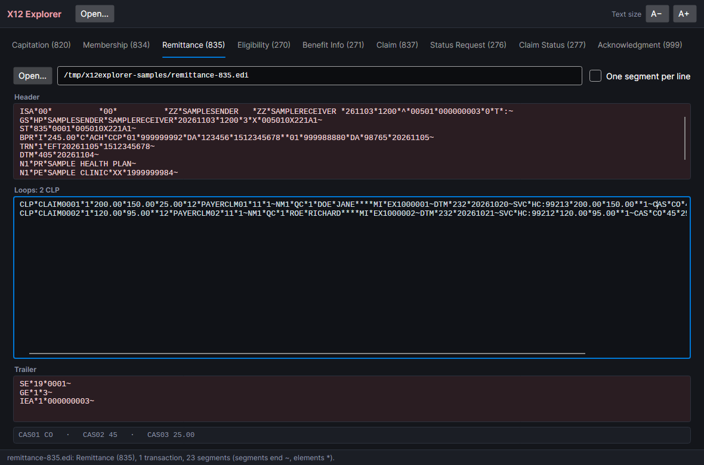
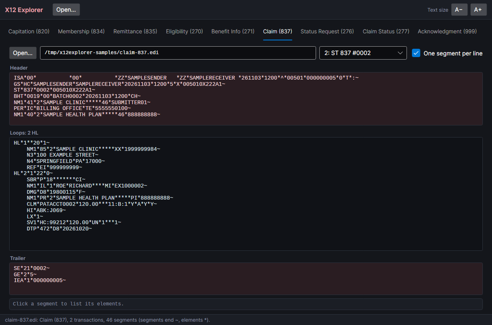
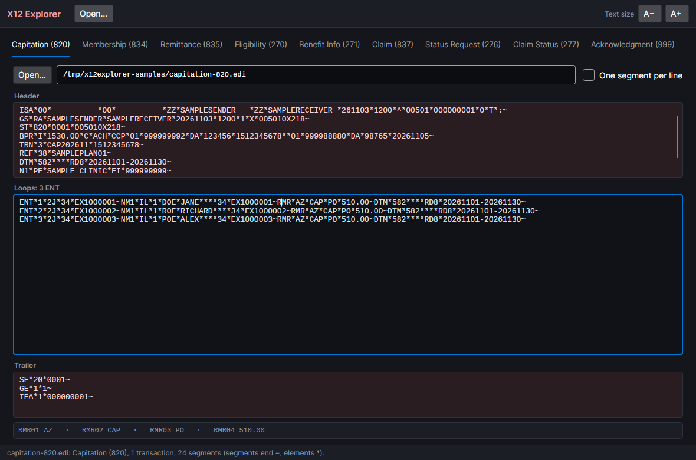
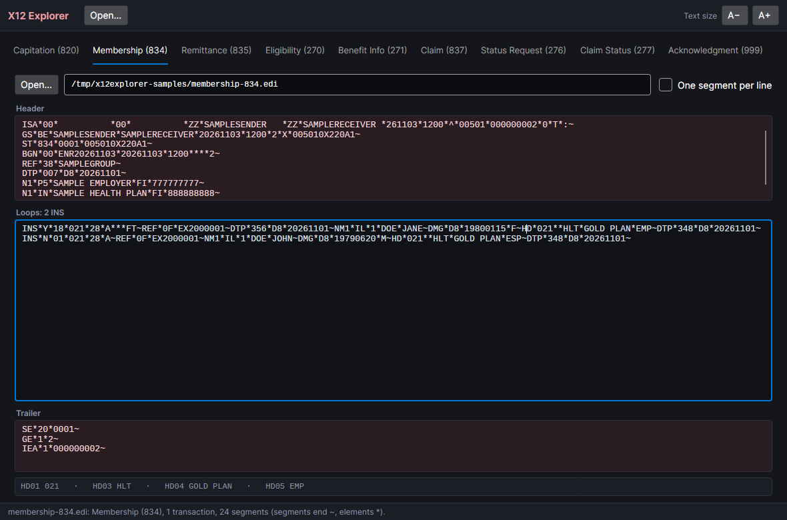
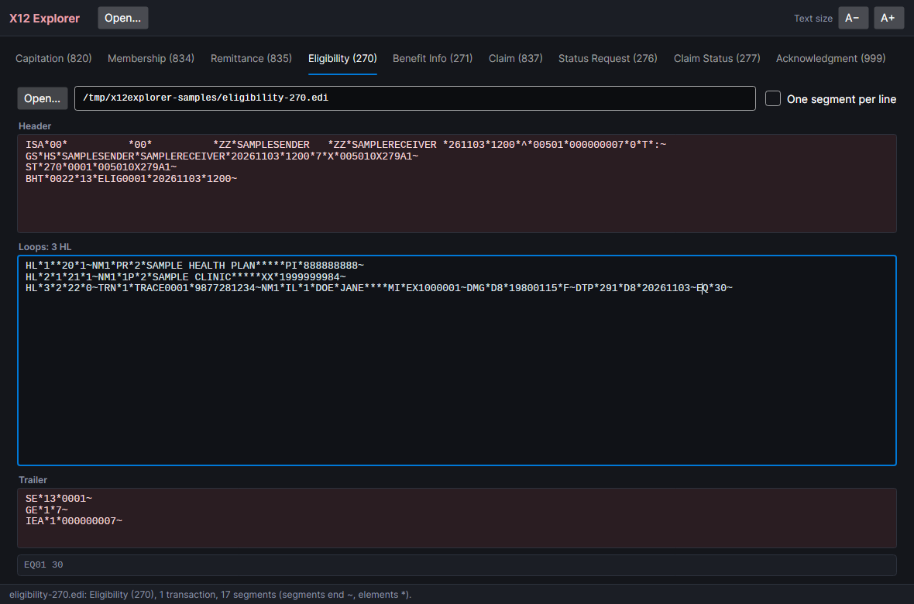
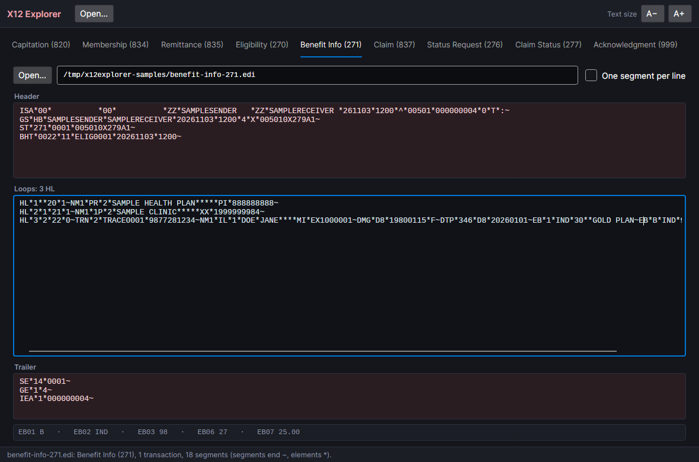
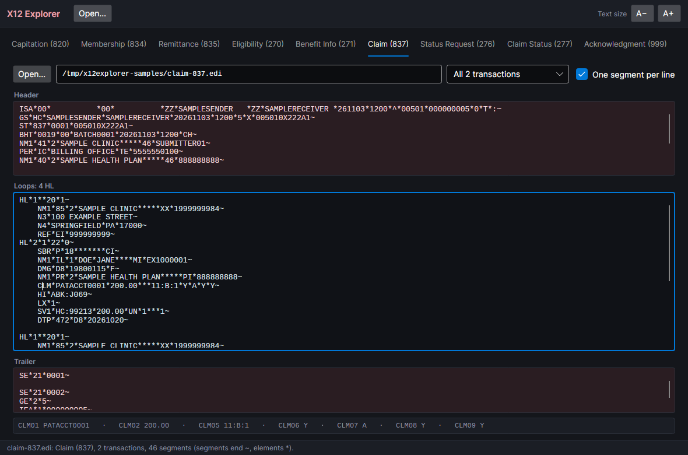
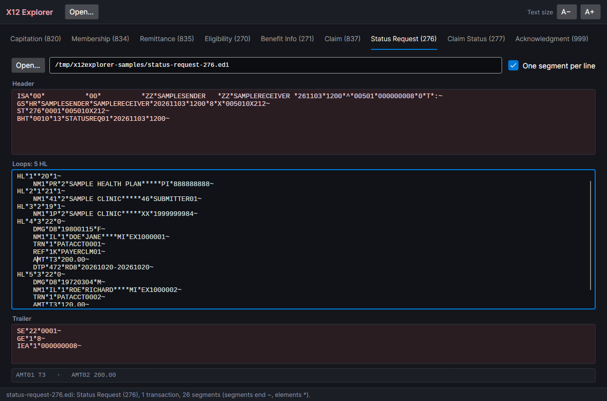
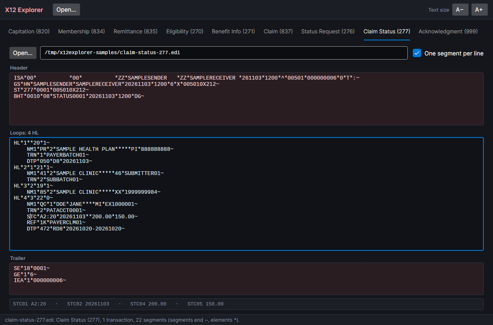
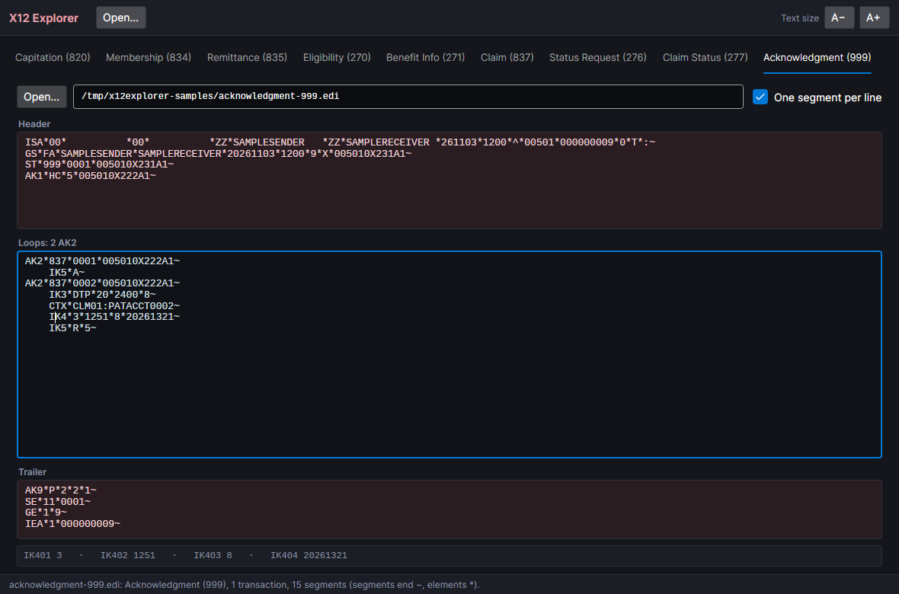

# X12 Explorer

A viewer for HIPAA X12 EDI files. X12 files usually arrive as one long line of `~`-terminated segments. X12
Explorer splits a file into three parts: the envelope and header, the loops, and the trailer. Each loop (one
claim, member or payment) gets a line of its own, or each segment does. Click any segment to list its elements.

It runs on Windows, macOS and Linux. It started as a Windows Forms program in VB.NET (kept in [`legacy/`](legacy))
and is now written in C# with [Avalonia](https://avaloniaui.net/).



## Download

Builds for Windows, macOS and Linux (Intel/AMD and ARM) are on the
[releases page](https://github.com/Harlock123/X12_820Explorer/releases). Each is a single self-contained program:
unzip or untar it and run `X12Explorer` (`X12Explorer.exe` on Windows). Nothing else needs installing.

## What it reads

| Tab | Transaction | Loops start at |
|---|---|---|
| [Capitation (820)](#capitation-820) | Premium payment, as used for capitation | `ENT` |
| [Membership (834)](#membership-834) | Benefit enrolment and maintenance | `INS` |
| [Remittance (835)](#remittance-835) | Claim payment and remittance advice | `CLP` |
| [Eligibility (270)](#eligibility-270) | Eligibility, coverage or benefit inquiry | `HL` |
| [Benefit Info (271)](#benefit-info-271) | Eligibility, coverage or benefit response (the 270's answer) | `HL` |
| [Claim (837)](#claim-837) | Health care claim | `HL` |
| [Status Request (276)](#status-request-276) | Claim status request | `HL` |
| [Claim Status (277)](#claim-status-277) | Claim status response (the 276's answer) | `HL` |
| [Acknowledgment (999)](#acknowledgment-999) | Implementation acknowledgment: accepted or rejected, and why | `AK2` |

- **Open a file from any tab.** It goes to the tab its `ST` segment names. You can also drop a file on the window,
  or name one on the command line (`X12Explorer claims.edi`).
- **Header, loops and trailer.** The header box shows the `ISA` and `GS` envelope, `ST`, and everything before the
  first loop. The trailer shows `SE`, `GE` and `IEA`. Drag the splitters to give a box more room.
- **One line per loop, or one segment per line.** Each loop starts out on one line on the 820, 834, 835, 270 and
  271 tabs. On the 837, 276, 277 and 999 tabs, each segment starts out on its own line, indented under the loop's
  first segment. A tick box switches between the two.
- **Every transaction in the file.** When a file holds several `ST`…`SE` transactions, a list picks one, or shows
  them all together.
- **Elements.** Click a segment in any box and the strip below lists its elements by position: `CLP01 CLAIM0001 ·
  CLP02 1 · CLP03 200.00 …`. Empty elements are left out, but the numbers still count them.
- **Any delimiters.** The segment terminator and the element and component separators come from the `ISA`
  segment, so files using `|`, `^`, `'` or line breaks read the same as `~` and `*`. Line breaks between segments
  are ignored, and so are segments that end with a bare line feed. A file without an `ISA` is read with `~` and
  `*`.
- **Text size.** The A− and A+ buttons (Ctrl+− and Ctrl+=) change the text size in every box.



## Transaction types

Each section covers what the transaction is for, what lands in each box, and the segments worth clicking. Every
type has a sample in [`tests/X12Explorer.Tests/Samples`](tests/X12Explorer.Tests/Samples) to try, and each
screenshot is that sample with one segment's elements listed.

### Capitation (820)

A health plan pays a provider a fixed amount per member per month and sends an 820 to say what the money covers.

- **Header:**
  - `BPR`: the payment. BPR02 is the total, BPR04 the method (`ACH`, `CHK`), and BPR16 the payment date.
  - `TRN`: the trace number that matches the payment.
  - `DTM*582`: the coverage period.
  - `N1*PE` and `N1*PR`: the payee and the payer.
- **Loops (`ENT`):** one per member.
  - `NM1*IL`: the member.
  - `RMR`: the amount paid for them (RMR04).
  - `DTM`: the period it covers.
- **Sample:** `capitation-820.edi` pays three members 510.00 each, which adds up to the 1530.00 in `BPR`. It's
  written as one long line, the way these files usually arrive.



### Membership (834)

An employer or other sponsor tells a health plan who is enrolled: additions, changes and terminations.

- **Header:**
  - `BGN`: the file's purpose, reference and date.
  - `REF*38`: the group policy number.
  - `DTP*007`: the effective date.
  - `N1*P5` and `N1*IN`: the sponsor and the insurer.
- **Loops (`INS`):** one per member.
  - INS01 is `Y` for the subscriber and `N` for a dependent. INS02 is the relationship (`18` self, `01` spouse),
    and INS03 is the change (`021` addition, `024` termination).
  - `REF*0F`: the subscriber's ID.
  - `NM1` and `DMG`: the name, date of birth and gender.
  - `HD`: the coverage. HD03 is the insurance line, HD04 the plan, and HD05 the coverage level.
  - `DTP*348`: the date the benefit starts.
- **Sample:** `membership-834.edi` adds a subscriber and her spouse to a plan.



### Remittance (835)

A payer explains a payment to a provider: what was paid on each claim, and why the rest wasn't.

- **Header:**
  - `BPR`: the total paid and how it was paid.
  - `TRN`: the check or EFT trace number.
  - `DTM*405`: the production date.
  - `N1*PR` and `N1*PE`: the payer and the payee.
- **Loops (`CLP`):** one per claim.
  - `CLP`: CLP01 is the provider's patient account number, CLP02 the status (`1` processed as primary, `4`
    denied), CLP03 the charge, CLP04 the amount paid, CLP05 the patient's share, and CLP07 the payer's claim number.
  - `NM1*QC`: the patient.
  - `SVC`: a service line.
  - `CAS`: an adjustment. CAS01 is the group (`CO` contractual, `PR` patient responsibility), CAS02 the reason
    code, and CAS03 the amount.
- **Sample:** `remittance-835.edi` pays 150.00 and 95.00 on two claims, which adds up to the 245.00 in `BPR`. The
  screenshot at the top of this page is this tab.

### Eligibility (270)

A provider asks a payer whether a patient is covered and for what. The answer is a 271.

- **Header:** `BHT`. BHT02 is `13`, a request.
- **Loops (`HL`):** one per level, nested by HL02 (the parent's HL01). HL03 names the level: `20` is the payer,
  `21` the provider asking, and `22` the subscriber.
- **The subscriber's level:**
  - `TRN`: a trace number, which the 271 sends back.
  - `NM1*IL` and `DMG`: who the subscriber is.
  - `DTP*291`: the date the question is about.
  - `EQ`: what's being asked. `30` means health benefit plan coverage.
- **Sample:** `eligibility-270.edi` asks about one subscriber.



### Benefit Info (271)

The payer's answer to a 270. It has the same levels, with the benefits filled in.

- **Header:** `BHT`. BHT02 is `11`, a response.
- **Loops (`HL`):** the payer, provider and subscriber levels again, with `TRN` echoing the 270's trace number.
- **The subscriber's level:**
  - `DTP*346`: when the plan began.
  - `EB`: one per benefit. EB01 is what kind (`1` active coverage, `B` co-payment, `C` deductible), EB03 the
    service type, EB06 the time period, and EB07 the amount.
- **Sample:** `benefit-info-271.edi` shows active coverage on a Gold plan and a 25.00 co-payment for office visits.



### Claim (837)

A provider bills a payer. This tab is for professional claims (837P), and institutional and dental 837s open here
too.

- **Header:**
  - `BHT`: the batch reference and date.
  - `NM1*41` and `PER`: the submitter and a contact.
  - `NM1*40`: the receiver.
- **Loops (`HL`):** each segment on its own line by default.
  - `HL*…*20`: the billing provider, with its address (`N3`, `N4`) and tax ID (`REF*EI`).
  - `HL*…*22`: the subscriber. `SBR`, `NM1*IL` and `DMG` describe them, and `NM1*PR` names the payer.
  - `CLM`: the claim. CLM01 is the patient account number, CLM02 the total charge, and CLM05 the place of service
    and frequency.
  - `HI`: the diagnoses (ICD-10).
  - `LX` and `SV1`: the service lines, each with its procedure code, charge and units.
  - `DTP*472`: the service date.
- **Sample:** `claim-837.edi` has two claims in two transactions, so the list above the boxes appears. Pick one,
  or show both.



### Status Request (276)

A provider asks what has happened to claims already sent. The answer is a 277.

- **Header:** `BHT`. BHT02 is `13`, a request.
- **Loops (`HL`):** `20` the payer, `21` the submitter, `19` the provider, and `22` one level per claim asked
  about. Each claim's level has:
  - `DMG` and `NM1*IL`: the patient.
  - `TRN*1`: the trace number, usually the patient account number.
  - `REF*1K`: the payer's claim number, if known.
  - `AMT*T3`: the claim's total charge.
  - `DTP*472`: the service dates.
- **Sample:** `status-request-276.edi` asks about two claims.



### Claim Status (277)

The payer's answer to a 276, or a report it sends on its own.

- **Header:** `BHT`. BHT02 is `08`, a status.
- **Loops (`HL`):** the same levels as the 276, with `TRN` on each echoing the trace numbers.
- **Each claim's level:**
  - `STC`: the status. STC01 is the category and status code (`A2:20` is accepted into adjudication and accepted
    for processing), STC02 the date, STC04 the charge, and STC05 the amount paid.
  - `REF*1K`: the payer's claim number.
- **Sample:** `claim-status-277.edi` reports one claim accepted for processing.



### Acknowledgment (999)

The receiver of a batch says whether each transaction in it passed its checks and, if not, where it failed.

- **Header:** `AK1`, the functional group being acknowledged. AK101 is its type (`HC` for 837s), and AK102 is the
  group's control number (its GS06).
- **Loops (`AK2`):** one per transaction. AK202 is the transaction's control number (its ST02). Under each:
  - `IK3`: a segment with errors. IK301 is the segment ID, IK302 its position counting `ST` as 1, and IK303 the
    loop.
  - `CTX`: context for finding it, such as the claim's CLM01.
  - `IK4`: the element in error. IK401 is its position, IK403 the error (`8` invalid date), and IK404 the bad
    value.
  - `IK5`: the verdict. `A` is accepted, `R` rejected, and `E` accepted with errors.
- **Trailer:** `AK9`, the group's summary, goes here, above `SE`, instead of joining the last loop. AK901 is `A`,
  `P` (partially accepted) or `R`, followed by the number of transactions included, received and accepted.
- **Sample:** `acknowledgment-999.edi` is the reply a batch of two 837 claims would get if the second carried the
  impossible service date 20261321. The first claim is accepted, the second rejected, and the group partly
  accepted.



## Trying it

Open any file in [`tests/X12Explorer.Tests/Samples`](tests/X12Explorer.Tests/Samples), or drop it on the window.
The names, member IDs, claim numbers and amounts in them are all invented. Don't add real files to the
repository: they carry personal health information.

## Building

You need the [.NET 10 SDK](https://dotnet.microsoft.com/download).

```bash
dotnet build X12Explorer.slnx
dotnet run --project src/X12Explorer [file]
dotnet test X12Explorer.slnx
```

## Project structure

- `src/X12Explorer.Core`: reading files, with no user interface code:
  - `Delimiters`: reads the delimiters from the `ISA` segment.
  - `X12File`: splits a file into segments and `ST`…`SE` transactions, each with its envelope.
  - `Views`: the text of the three boxes.
  - `Elements`: finds the segment under the caret and lists its elements.
  - `TransactionKind`: the nine tabs.
- `src/X12Explorer`: the window (`MainWindow`) and one `TransactionPage` per tab, built in code.
- `tests/X12Explorer.Tests`: xUnit tests for the reader, plus headless window tests. Set `X12_SHOTS` to a folder to
  save pictures of the window; the screenshots here come from them.
- `legacy/`: the original Windows Forms program (VB.NET, .NET Framework 4.8), for reference.

## Licence

MIT. See [LICENSE](LICENSE).
